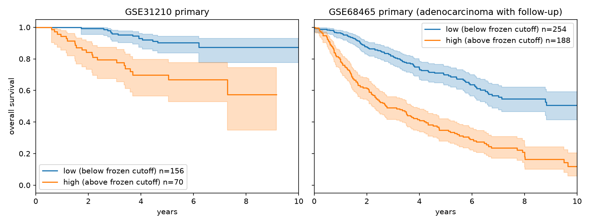
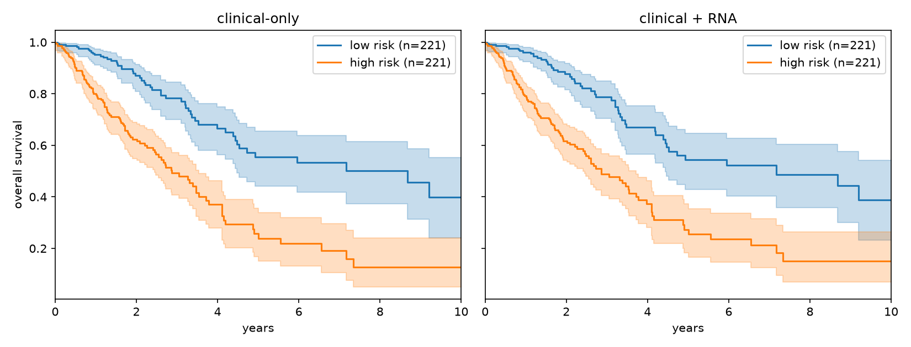
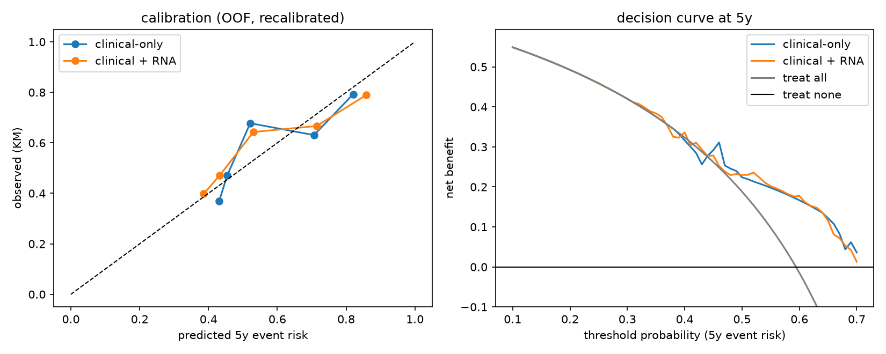

# Multi-omics survival biomarker for lung adenocarcinoma

A leakage-controlled pipeline that turns more than 50,000 noisy molecular features from fewer than 500 TCGA-LUAD patients into a prognostic signature for censored overall survival, then tests that signature on two independent cohorts without refitting anything.

**Full write-up:** [`multiomics_biomarker_report.pdf`](multiomics_biomarker_report.pdf) (6 pages)

## Headline results

| Question | Answer |
|---|---|
| Does multi-omics integration beat clinical-only (age + sex + stage) inside TCGA? | **No, not detectably.** Best model (clinical + RNA) gained +0.012 Uno C, 95% CI [-0.026, +0.049]. The pre-specified criterion was not met and is reported as such. |
| Does a frozen clinical + 5-gene RNA signature validate externally? | **Yes.** Harrell C 0.715 [0.627, 0.792] in GSE31210 (n=226) and 0.697 [0.661, 0.734] in GSE68465 (n=442). High vs low risk HR 4.36 and 2.90. |
| Where does the discrimination come from? | Mostly the clinical part (C 0.68-0.69 alone). RNA adds a small, real effect in GSE68465 (likelihood-ratio p = 0.002) and nothing detectable in the small, early-stage GSE31210. |
| Is it reproducible? | `make reproduce` rebuilds every table and figure from the raw downloads. The regenerated signature file is bit-identical to the frozen one. |

<p align="center">
  
</p>

## Design principles

- **No leakage.** Every data-dependent step (filters, imputation, screening, scaling, penalty tuning) is refitted inside each training fold.
- **Nested, repeated, stratified CV** with identical folds for every model, so differences are paired. Confidence intervals use the Nadeau-Bengio correction.
- **Always compare to baselines:** clinical-only, each single omic, early / late / MOFA+ integration, and untuned random survival forests and gradient boosting.
- **Frozen before external data.** The signature, preprocessing and cutoff are written to `results/models/signature_v1.json` with a recorded sha256. The external script checks the hash and refuses to run twice without `--rerun`.
- **Success criteria were fixed in advance**, including a calibration-slope rule (1 ± 0.3). Calibration was met in GSE68465 and not in GSE31210.

## The frozen signature

Elastic-net Cox on clinical covariates (unpenalised) plus RNA, restricted to the 11,753 genes measurable on TCGA and both external array platforms.

| Component | Terms (log hazard per SD) |
|---|---|
| Clinical | age +0.064, male -0.011, stage II +0.344, III +0.430, IV +0.291 |
| RNA | DKK1 +0.148, TLE1 +0.116, SEC61G +0.019, LDHA +0.010, USP4 -0.009 |

## Internal comparison (TCGA-LUAD, 442 patients, 159 deaths)

Uno C at 5 years, repeated 5x5 CV. See the report for Harrell C, intervals and every other strategy.

| Model | Uno C |
|---|---|
| Clinical baseline (age + sex + stage) | 0.636 |
| Clinical + RNA | 0.648 |
| Clinical + RNA, shared-gene pool (the frozen model) | 0.650 |
| Late integration (stacking) | 0.634 |
| Clinical + MOFA+ factors | 0.613 |
| Random survival forest / gradient boosting, clinical + omics | 0.579 / 0.574 |

<p align="center">
  
  
</p>

## Reproducing

Requires Python 3.12 and about one hour on a laptop plus roughly 2 GB of disk for the raw downloads.

```bash
git clone https://github.com/rushadnihal/multi-omics-biomarker-pipeline.git
cd multi-omics-biomarker-pipeline
bash setup.sh          # virtual environment and dependencies
source .venv/bin/activate
make test              # unit tests
make reproduce         # download, build, evaluate, freeze, validate, summarise
```

Individual stages are available as make targets: `data`, `cohort`, `matrices`, `baselines`, `integration`, `nonlinear`, `internal-eval`, `signature`, `external`, `summary` (see `reproduce.mk`).

Raw data are not stored in this repository. They are downloaded by `scripts/01_download.py`: the TCGA-LUAD RNA-seq, 450K methylation and miRNA matrices with the curated survival table, and GEO series GSE31210 and GSE68465.

## Repository layout

```
config/          all settings and seeds (config.yaml)
src/mosurv/      in-fold preprocessing, models, MOFA+ projection, signature scoring
scripts/         numbered pipeline steps, 00 (inspection) through 18 (verify and summarise)
tests/           unit tests (leakage-sensitive pieces and signature scoring)
results/         tables, figures, frozen signature, reproduction log
docs/STATE.md    running log of decisions and status
reproduce.mk     one-command reproduction stages
```

## Limitations

- The internal confidence intervals (about ±0.035 on Uno C) cannot exclude gains of up to about 0.05 from adding omics.
- GSE68465 stage was derived from pT/pN codes (no stage IV); three patients without stage were scored as stage I. GSE31210 contains only stage I-II patients.
- The signature uses genes shared by TCGA and both array platforms, so it ignores 81% of RNA features (they cost nothing in cross-validation).
- Copy-number and somatic-mutation layers were not used, and methylation SNP / cross-reactive probes were not filtered.
- A mild proportional-hazards departure was seen for the risk score (Schoenfeld p = 0.026).
- This is a research analysis of public data, not a clinical tool.

## Data sources

TCGA-LUAD via the curated pan-cancer survival table (Liu et al., Cell 2018); GEO GSE31210 (Affymetrix GPL570) and GSE68465 (GPL96).
